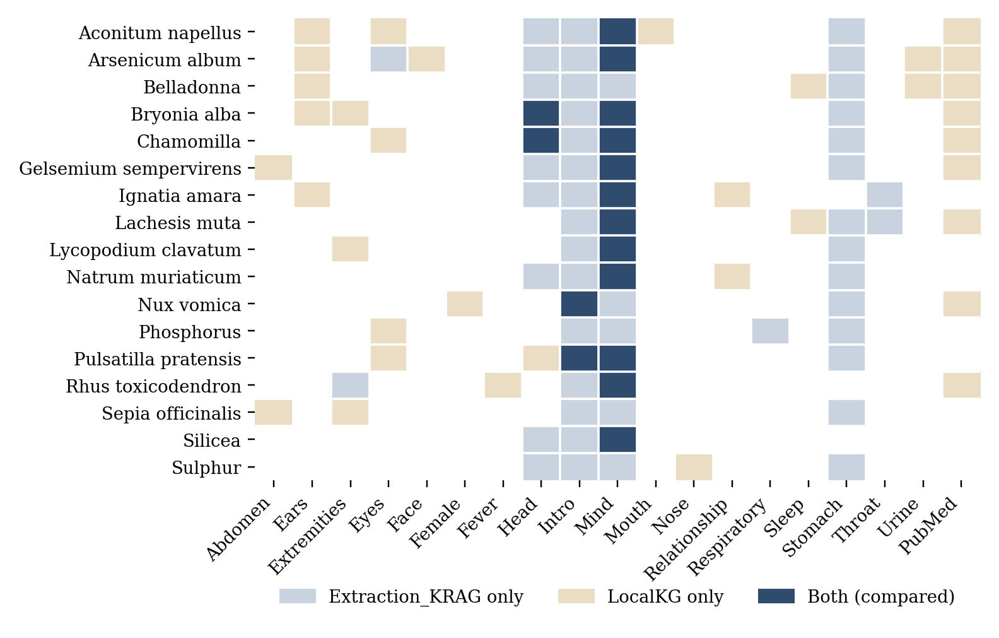
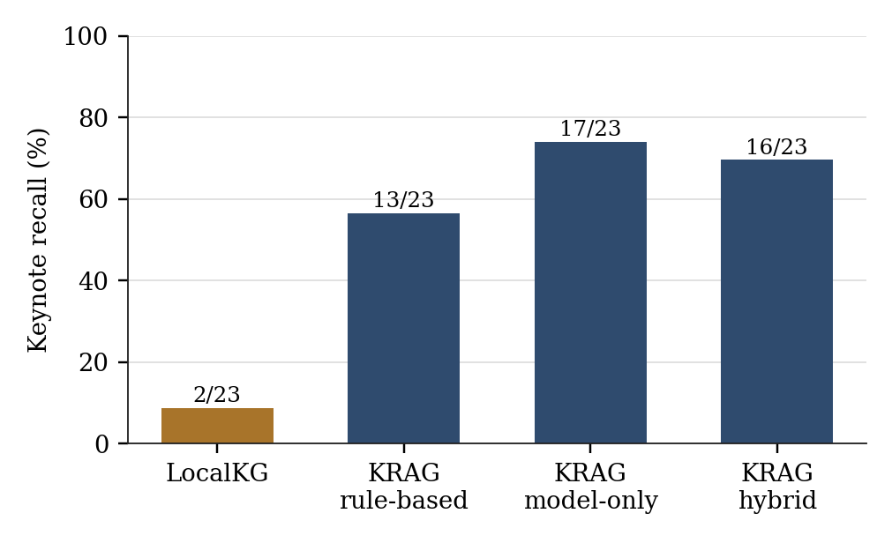
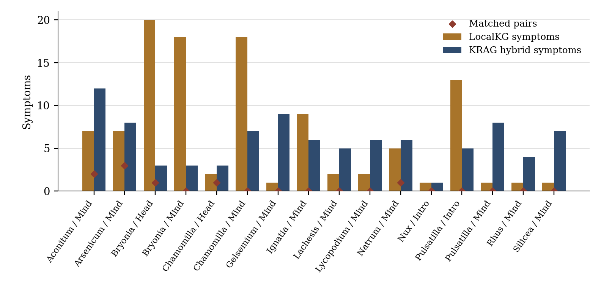
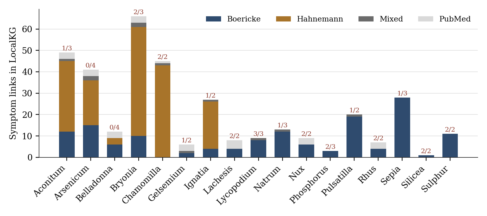

# LocalKG vs Extraction_KRAG: Comparison of the Two Knowledge Graphs

This study compares the two knowledge graphs built in this repository, restricted to the
remedies present in both and, within each remedy, to the sections populated in both. The
aim is to explain how differences in the two pipelines lead to differences in the graphs.

All numbers are produced by `LocalKG/experiments/compare_localkg_vs_krag.py`. Raw results
are in `docs/kg_comparison/comparison_metrics.json`.

```
python LocalKG/experiments/compare_localkg_vs_krag.py
```

## 1. What is being compared

| | Extraction_KRAG | LocalKG |
|---|---|---|
| Graph file | `ui/graph_data*.json`, built from `data/extracted/run_*.jsonl` | `data/extracted/kg_full_materia_medica_cleaned.graph.json` |
| Source text | Boericke, *Pocket Manual* (clean section text for 20 remedies) | Boericke *Pocket Manual* (OCR pages) and Hahnemann, *Materia Medica Pura* (OCR pages), plus 21 PubMed records |
| Remedy and section detection | Chunks arrive already split by remedy and by a fixed set of sections (Intro, Mind, Head, Stomach, Modalities, Relationship) | Remedy found from OCR'd running headers and capitalised headings; Hahnemann sections assigned by a keyword classifier |
| Page sampling | Every chunk of the 20 remedies | Boericke: 2 to 4 pages per remedy. Hahnemann: up to 8 sampled pages per remedy, each section capped at 3,200 characters |
| Extractor | Three variants: rule-based, model-only (`gpt-oss-120b` on Groq), hybrid (rules, then model audit) | Local `qwen2.5:7b-instruct` through Ollama with JSON-schema constrained decoding |
| Prompt | `extract_v1` (verbatim wording, list splitting) | `extract_v2` (adds affect and cognitive-domain fields) |
| Node identity | Scoped to the remedy (`sym:<Remedy>:<label>`), so nodes are never shared between remedies | Global after alias resolution (`symptom:<slug>`), so nodes can be shared between remedies |
| Symptom type | Taken from the extractor's `symptom_kind` | Taken from the section: symptoms in a Mind section become Affective Symptom nodes |

**Remedies compared.** Extraction_KRAG covers 20 remedies and LocalKG 41. Seventeen are in
both (Lachesis *muta*/*mutus* and Pulsatilla *pratensis*/*nigricans* are treated as the same
remedy). Calcarea carbonica, Staphysagria and Thuja are only in Extraction_KRAG.

**Sections compared.** Across the 17 remedies, only 16 (remedy, section) pairs have symptoms
in both graphs: 13 Mind, 2 Head (Bryonia, Chamomilla) and 2 Intro (Nux vomica, Pulsatilla),
counting Bryonia and Chamomilla once each for Mind and Head (Figure 1).



*Figure 1. Sections populated for each shared remedy. Dark cells are the pairs compared in
Section 3. LocalKG has no Stomach section for any of these remedies, and Extraction_KRAG
has no Ears, Eyes or Urine sections for most of them.*

## 2. Headline results

| Measure (17 shared remedies) | LocalKG | KRAG rule-based | KRAG model-only | KRAG hybrid |
|---|---|---|---|---|
| Gold keynote recall (23 keynotes, 7 remedies) | **2 / 23 (9%)** | 13 / 23 (57%) | **17 / 23 (74%)** | 16 / 23 (70%) |
| Symptom links | 355 (329 excluding PubMed) | 253 | 240 | 271 |
| Symptoms in shared sections | 108 | 80 | 93 | 93 |
| Matched with LocalKG in shared sections | n/a | 7 | 9 | 8 |
| Matched with LocalKG, whole remedy | n/a | 13 | 12 | 12 |
| "Mind" symptoms naming a body part or complaint | **33 / 72 (46%)** | 1 / 64 | 1 / 87 | 1 / 81 |
| Share of symptoms typed as mental | 22.5% | 37.5% | 52.9% | 42.4% |
| Modality edges | 34 | 45 | 157 | 97 |
| Labels kept verbatim from source | No (normalised to title case) | 100% | 95.0% | 94.8% |

Keynote recall uses the same rule as `hkg.eval.metrics` (`fuzz.ratio >= 75`). Two symptoms
are counted as matched when their normalised `fuzz.ratio` or `token_set_ratio` is at least 75.
The "Mind" check is a whole-word keyword test for body parts and physical complaints (for
example *colic*, *cough*, *chest*, *nausea*); the full list is in the script.

The two graphs share almost nothing. Even when the remedy and the section agree, fewer than
one symptom in ten appears in both (8 matches out of 93 hybrid and 108 LocalKG symptoms), and
LocalKG recovers only 2 of the 23 gold keynotes. Section 4 traces this to four pipeline stages.



*Figure 2. Recall of the 23 gold keynotes that belong to shared remedies.*

## 3. Shared sections in detail



*Figure 3. Symptom counts in each shared (remedy, section) pair, with the number of
LocalKG symptoms that match a hybrid-pipeline symptom.*

The pairs fall into three groups.

**Same text, different labels (Aconitum, Arsenicum Mind).** Both graphs drew on Boericke's
Mind paragraph, and these are the only pairs with more than one match. Extraction_KRAG keeps
the source wording ("Great fear", "Fear of death", "Restless; tosses about"). LocalKG
normalises it ("Fear of Death", "Fear of Future", "Startle Easily"), so phrases such as
"tosses about" have no counterpart to match.

**Different text under the same section name (Bryonia, Chamomilla, Ignatia).** These pairs
are among the largest on the LocalKG side, but they come from Hahnemann's proving lists
rather than Boericke's summaries. Chamomilla shows the effect most clearly:

| Extraction_KRAG hybrid, Chamomilla Mind | LocalKG, Chamomilla Mind |
|---|---|
| Whining restlessness; Child wants this and that and becomes petulant; must be carried about constantly; Impatient; intolerant of pain; Snappish; irritable | Pains Aggravated by Eructation; Nausea After Meal; Epigastric Flatulence; Pain Above Navel; Flatulent Colic; Distended Abdomen; Colic (18 in total) |

None of the 18 LocalKG entries is a mental symptom. They are gastric symptoms from a
Hahnemann page whose paragraph contained a mood word, which sent the whole paragraph to Mind
(Section 4.3). Because LocalKG derives the node type from the section, all 18 were stored as
Affective Symptom nodes and mapped to cognitive domains.

**Near-empty LocalKG sections (Gelsemium, Lachesis, Lycopodium, Pulsatilla, Rhus, Silicea
Mind).** Extraction_KRAG has 4 to 9 Mind symptoms for each, LocalKG 1 or 2. LocalKG's
Boericke pages for these remedies are mostly not about these remedies (Section 4.1), and
Gelsemium's single "Mind" symptom, "Abdominal Pain", is a shared node whose section was set
by another remedy (Section 4.4).

## 4. How the pipelines produce these differences

### 4.1 Remedy attribution from OCR page headers (LocalKG)

LocalKG locates each Boericke remedy by matching OCR'd running headers and capitalised
headings against a remedy list, then samples two to four pages. For every Boericke page used
for the 17 shared remedies, the script reads the remedy headings printed on that page and the
page before it:

| Result | Pages |
|---|---|
| Heading of the intended remedy present | 15 |
| Only headings of other remedies present | 25 |
| No heading on either page (inside a long entry) | 4 |

So most of these pages contain other remedies. The error grows through the alphabet: the
page chosen increasingly falls on a remedy that comes after the intended one in the book.

| LocalKG remedy | Pages used | Remedies printed on those pages |
|---|---|---|
| Aconitum napellus | 21 | Acalypha indica, Acetic acid |
| Lycopodium clavatum | 424, 426, 427 | Magnesia muriatica, Magnesia phosphorica, Magnesia sulphurica |
| Nux vomica | 493, 495 | Oleum jecoris aselli, Oniscus |
| Rhus toxicodendron | 569, 570 | Ruta graveolens, Sabadilla |
| Silicea | 606, 609 | Solanum, Spigelia, Spongia |
| Sulphur | 634, 636 | Sumbul, Symphoricarpus, Symphytum |

Every symptom extracted from such a page is filed under the wrong remedy. LocalKG's "Sulphur"
subgraph, for example, contains 11 Nose symptoms ("Caries of nasal bones, hard palate and
septum, with perforation") that describe a neighbouring remedy rather than Sulphur.
Extraction_KRAG avoids this entirely because its chunks arrive already labelled by remedy.



*Figure 4. Source of the symptom links attached to each shared remedy in LocalKG. The red
fraction above each bar is the number of Boericke pages used for that remedy that belong to
another remedy, out of all Boericke pages used.*

### 4.2 Sampling instead of full coverage (LocalKG)

LocalKG reads two to four Boericke pages and up to eight Hahnemann pages per remedy, and caps
each section at 3,200 characters. Which sections survive therefore depends on which pages
were sampled. This is why LocalKG has no Stomach section for any shared remedy and no Mind
section for Belladonna, Phosphorus or Sulphur, while Extraction_KRAG, which reads every chunk
of each remedy, has a Mind and Intro section for all 17. Gold keynotes sit mostly in Mind and
Stomach, which accounts for most of LocalKG's low keynote recall.

### 4.3 Keyword section classification (LocalKG, Hahnemann pages)

Hahnemann's *Materia Medica Pura* lists numbered proving observations without Boericke-style
section headings. LocalKG assigns each paragraph to a section with an ordered keyword test in
which the Mind words are checked first. A paragraph of twenty gastric observations that
contains "anxiety" or "restless" once is therefore filed as Mind as a whole. The same test
produces "Ears" and "Eyes" sections that contain throat, tongue and tooth symptoms (for
example, Aconitum "Eyes": "Shooting pain in various teeth", "Smarting sensation in the
tongue"). Overall, 46% of LocalKG's Mind symptoms for these remedies name a body part or
physical complaint, against 1 symptom in each Extraction_KRAG variant (and that one,
"intolerant of pain", is a genuine mental symptom).

### 4.4 Graph merging and node scope

LocalKG resolves aliases across the whole corpus, so a symptom that appears for several
remedies becomes one node. Such a node keeps a single `section` attribute, which then appears
in every remedy that links to it. Only 2.8% of LocalKG symptom nodes are shared, but they
supply 27 of the 355 links in this comparison, including Gelsemium's only Mind symptom.
Extraction_KRAG scopes every node to its remedy, so section and type are never inherited from
another remedy. The trade-off is that Extraction_KRAG cannot show that two remedies share a
symptom, which LocalKG can.

### 4.5 Extractor and prompt

With the source text fixed, the extractor determines the wording and granularity of the
symptoms.

- **Verbatim versus normalised labels.** Extraction_KRAG's prompt requires the exact source
  wording, and 95% to 100% of its symptoms occur verbatim in their evidence quote. LocalKG's
  local 7B model produces short canonical labels ("Forehead Tearing Pain", "Satiety
  Fulness"). The labels read well, but they lose qualifiers and cannot be checked against the
  text by string search, which also lowers measured overlap with Extraction_KRAG.
- **Fragmentation.** All pipelines produce some one-word symptoms where a list was split too
  finely: 49 in LocalKG, 58 rule-based, 53 model-only and 82 hybrid. The hybrid count is
  highest because the audit keeps the rule stage's splits ("Mild", "gentle", "timid",
  "yielding" from one Pulsatilla phrase) and only removes non-symptoms.
- **Header artefacts.** The rule-based extractor turned 74 chunk headers (`### Remedy:
  Section`) into symptoms. The hybrid audit removed all but 6; the model-only run produced
  none. These were excluded from every count above.
- **Modalities.** The model-only extractor attaches modalities to individual symptoms
  (157 edges), the hybrid audit keeps fewer (97), and the rule-based and LocalKG pipelines
  capture mostly section-level modalities (45 and 34).
- **Grades.** The rule-based extractor marks 150 of 253 symptoms as grade 3 because it reads
  section headings and capitalised words as emphasis. The model-based pipelines assign grade 3
  far less often (63 model-only, 46 hybrid, 24 LocalKG).

## 5. Summary

| Pipeline stage | Effect on Extraction_KRAG | Effect on LocalKG |
|---|---|---|
| Source text | Clean Boericke sections; consistent with the gold set | Mixed Boericke and Hahnemann OCR; Hahnemann's proving lists dominate several remedies |
| Remedy detection | Given by the input | 25 of 44 audited Boericke pages belong to another remedy |
| Section detection | Given by the input | Keyword classifier; 46% of Mind symptoms are bodily |
| Coverage | All chunks of each remedy | Sampled pages; no Stomach sections and missing Mind sections |
| Extraction | Verbatim wording, high recall (model-only 74%, hybrid 70%) | Normalised labels; keynote recall 9% |
| Graph assembly | Remedy-scoped nodes, no sharing | Global nodes; section and type inherited across remedies |

The low agreement between the two graphs is caused mainly by the stages before extraction:
which text is read, which remedy and section it is assigned to, and how much of it is read.
Within the 16 shared pairs, the extractor and prompt explain the remaining differences in
wording and granularity. Fixing LocalKG's remedy attribution and section classification would
matter more than changing its language model.

## 6. Limitations of this study

- Extraction_KRAG's input chunks are not stored in the repository, and every occurrence
  carries the page reference `p.1`, so its text could not be audited page by page.
- The page audit uses OCR'd headings. Pages with no printed heading are reported separately
  rather than counted as errors, and a heading may occasionally be missed if OCR damages it.
- Fuzzy matching undercounts paraphrases that use different words (for example "Weeps easily"
  and "Tearfulness").
- The gold set is small (23 keynotes in the shared remedies) and was written from Boericke,
  which favours Extraction_KRAG's source.
