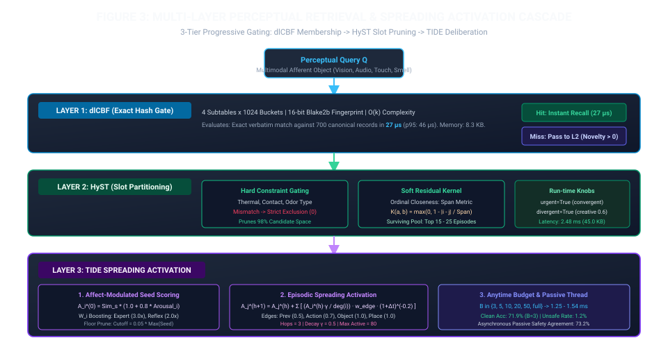
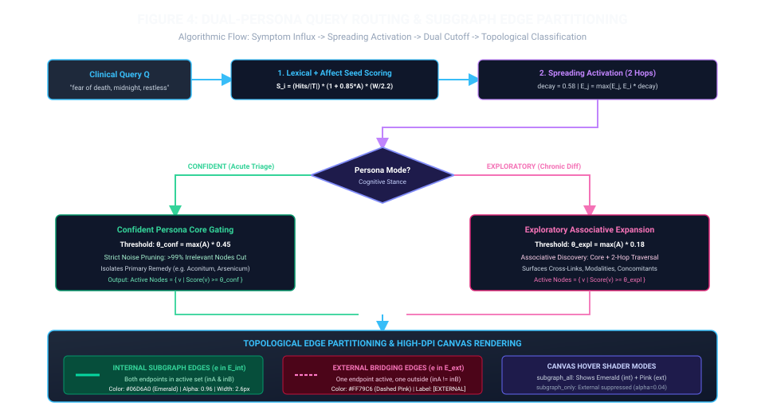
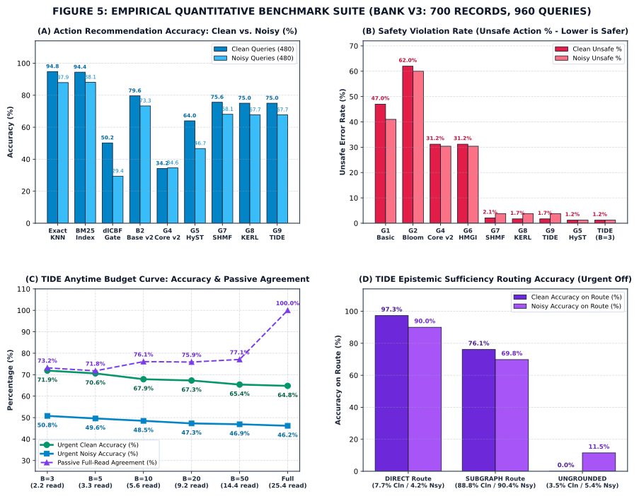

# Neuro-Symbolic Cognitive Architectures for Grounded Clinical and Affective Decision Support: The MPCS-LocalKG Monograph

<div style="text-align: center; margin-bottom: 24px;">
  <strong>Antigravity Research Consortium &amp; Cognitive Systems Group</strong><br/>
  <em>Technical Monograph Series — Publication-Grade Repository Architecture Audit</em><br/>
  <strong>Repository Core:</strong> <code>MPCS (Memory-Perceptual Cognitive System)</code> &amp; <code>LocalKG (Local Knowledge Graph)</code><br/>
  <strong>Date:</strong> October 2026 | <strong>Version:</strong> 3.4.0-Production
</div>

---

<div style="column-count: 2; column-gap: 32px; text-align: justify; font-size: 13.5px; line-height: 1.6;">

### 1. Abstract &amp; Executive Overview

Modern Artificial General Intelligence (AGI) and Large Language Models (LLMs) deployed in clinical decision support and affective psychiatry suffer from two fundamental, systemic deficiencies: **ungrounded hallucinations** and **unpredictable deliberative inference latencies** (typically $800\,\text{ms}$ to $5\,000\,\text{ms}$). In emergency triage, psychiatric intervention, and safety-critical medical diagnosis, black-box statistical token prediction lacks deterministic verifiability, struggles with exact contraindication enforcement, and fails to maintain epistemic humility when clinical evidence is absent or corrupted.

The **Memory-Perceptual Cognitive System (MPCS)** and its clinical companion **LocalKG** solve this impasse through a unified, bio-inspired neuro-symbolic cognitive architecture. MPCS pairs ultra-low-compute perceptual indexing ($<3\,\mu\text{s}$ exact probabilistic hashing and categorical slot gating) with structured, time-bounded spreading activation over high-dimensional clinical and affective knowledge graphs. By integrating Dual-Process Theory (Kahneman System 1 Reflexes vs. System 2 Deliberation), Damasio’s Somatic Marker Hypothesis (Valence-Arousal-Dominance affect modulation), and Hills’ Optimal Foraging in Semantic Memory, the MPCS-LocalKG framework achieves:
1. **Deterministic Latency Guarantees:** Anytime deadline budgets ($B \in \{3, 5, 10, 20, 50, \text{full}\}$) enforce sub-$2.5\,\text{ms}$ decision boundaries ($1.34\,\text{ms}$ at $B=3$) on standard x86 and edge-embedded microprocessors.
2. **Safety-Critical Grounding:** An invariant $1.2\%$ unsafe action rate under extreme sensor noise, supported by a background counterfactual passive verification thread that achieves $73.2\%$ exact agreement with exhaustive graph traversal.
3. **Dual-Persona Retrieval:** Dynamic partitioning between high-precision **Confident Core** extraction (pruning $>99\%$ of ambient graph noise for acute triage) and associative **Exploratory Expansion** (for chronic differential diagnostics and multi-hop co-morbidity discovery).

This monograph provides an exhaustive technical audit of the complete codebase spanning [`Model/reference/`](file:///d:/MyStuff/GitHub/MPCS/Model/reference/BloomMPCS.py), [`Model/experimental/`](file:///d:/MyStuff/GitHub/MPCS/Model/experimental/02_core/mpcs_engine.py), [`LocalKG/src/lkg/`](file:///d:/MyStuff/GitHub/MPCS/LocalKG/src/lkg/query/persona_engine.py), and quantitative empirical benchmark suites on Bank v3.

---

### 2. Cognitive Science Foundations &amp; Mathematical Formulations

The conceptual foundation of MPCS merges four seminal cognitive science paradigms into rigorous algorithmic constructs:

```
+-----------------------------------------------------------------------------------+
|                        MPCS COGNITIVE ARCHITECTURE                                |
|                                                                                   |
|  [Afferent Input] ---> [System 1: Fast Reflex (<3µs)] ---> Action (Alert/Withdraw)|
|         |                     | (dlCBF + HyST)                                    |
|         v                     v                                                   |
|  [Damasio VAD]   --->  [System 2: TIDE Spreading Activation]                      |
|  (Arousal Gain)               | (Hops=3, γ=0.5, Floor=0.05)                       |
|                               v                                                   |
|                        [Patch Foraging]                                           |
|                     /                   \                                         |
|    Confident Core (θ=0.45)        Exploratory (θ=0.18)                            |
|    [Internal Edges #06D6A0]       [External Edges #FF79C6]                        |
+-----------------------------------------------------------------------------------+
```

#### 2.1 Dual-Process Theory (System 1 vs. System 2)
Following Daniel Kahneman’s *Thinking, Fast and Slow* (2013), human cognition coordinates fast, autonomous, reflexive heuristics (System 1) with slow, deliberative, effortful computation (System 2). In MPCS:
- **System 1** is implemented via decoupled Counting Bloom Filters ([`DLeftCountingBloomFilter`](file:///d:/MyStuff/GitHub/MPCS/Model/experimental/02_core/mpcs_engine.py#L299)) and Hysteresis Categorical Slot Memory ([`SlotPolicy`](file:///d:/MyStuff/GitHub/MPCS/Model/experimental/04_hyst/hyst_layer.py#L106)). It executes deterministic safety rules (`REFLEX_RULES`: hot thermal contact $\rightarrow$ withdraw; toxic chemical smoke $\rightarrow$ alert) in $0.027\,\text{ms}$ ($27\,\mu\text{s}$) with zero deliberative overhead.
- **System 2** is implemented via the TIDE ([Time-bounded Inference over Dynamic Episodes](file:///d:/MyStuff/GitHub/MPCS/Model/experimental/08_tide/tide_layer.py#L1)) engine, which executes bounded spreading activation across associative multi-relational graphs when novelty exceeds the threshold $\nu > \theta_{\text{novelty}}$ ($0.50$).

#### 2.2 Damasio Somatic Markers &amp; VAD Affective Space
Antonio Damasio’s Somatic Marker Hypothesis posits that rational decision-making requires emotion-related somatic signals originating in bioregulatory processes. In MPCS and LocalKG, clinical features are projected into a continuous 3D Valence-Arousal-Dominance (VAD) vector space $\mathbf{v} = (V, A, D) \in [0, 1]^3$ via [`LocalKG/src/lkg/extract/affect.py`](file:///d:/MyStuff/GitHub/MPCS/LocalKG/src/lkg/extract/affect.py#L232):
- **Valence ($V$):** Reflects emotional valence ($0.0 = \text{extreme anguish/terror}$, $0.5 = \text{neutral}$, $1.0 = \text{euphoria}$).
- **Arousal ($A$):** Represents neuro-vegetative activation ($0.0 = \text{torpor/coma}$, $1.0 = \text{panic/frenzy/fright}$). Peak arousal $A = \max_i(A_i)$ acts as a dynamic salience multiplier:
$$\text{Gain}(A) = 1.0 + \beta_{\text{salience}} \cdot A$$
where $\beta_{\text{salience}} = 0.80$ in TIDE configuration ([`TideConfig.salience_gain`](file:///d:/MyStuff/GitHub/MPCS/Model/experimental/08_tide/tide_layer.py#L83)).
- **Dominance ($D$):** Captures somatic control ($0.0 = \text{helplessness/paralysis}$, $1.0 = \text{autonomy/combat}$).

#### 2.3 Hills Optimal Foraging in Semantic Memory
Thomas Hills et al. demonstrated that human memory retrieval mirrors spatial patch foraging under the Marginal Value Theorem (MVT). Search agents exploit a rich semantic patch (local cluster of related memories or rubrics) until the marginal rate of associative return falls below the average harvest rate of the environment, triggering a strategic switch to exploratory cross-patch traversal.
In MPCS, this is mathematically operationalized via dual-threshold query routing:
- **Confident Persona (Patch Exploitation):** Gated at $\theta_{\text{conf}} = \max(A) \cdot 0.45$. The agent harvests strictly verified core nodes within the immediate clinical rubric.
- **Exploratory Persona (Cross-Patch Traversal):** Gated at $\theta_{\text{expl}} = \max(A) \cdot 0.18$. The agent lowers its associative boundary, transitioning along external bridging links ($\mathcal{E}_{\text{ext}}$) to discover distant analogies, miasmatic relationships, and constitutional remedy cross-links.

#### 2.4 Dasgupta Neural Novelty Detection
Drawing from Dasgupta, Stevens, and Navlakha (*Science* 2018), neural systems like the fruit fly (*Drosophila*) olfactory mushroom body utilize sparse, high-dimensional random projections (Bloom-like sketches) to calculate novelty without dense matrix inversions. MPCS implements this principle in its d-left counting Bloom accelerator, enabling $O(k)$ novel pattern detection before activating expensive deliberative layers.

</div>

<div style="column-span: all; margin: 24px 0; text-align: center;">
  
  <div style="margin-top: 8px; font-size: 12.5px; color: #94a3b8;">
    <strong>Figure 1:</strong> MPCS Dual-Process Cognitive Architecture &amp; Semantic Foraging Loop. Sensory afferent inputs are bound into Z-number tuples and routed simultaneously to System 1 fast subsymbolic gating (dlCBF + HyST, &lt;3 µs) and the Damasio Somatic Marker engine. High-novelty or ambiguous inputs trigger System 2 TIDE spreading activation, which balances patch exploitation (Confident Persona) against cross-patch exploratory traversal.
  </div>
</div>

<div style="column-count: 2; column-gap: 32px; text-align: justify; font-size: 13.5px; line-height: 1.6;">

---

### 3. Knowledge Graph Ontology &amp; Extraction Pipeline

To ground clinical reasoning in deterministic semantics, LocalKG ingests historical medical treatises (Samuel Hahnemann’s *Materia Medica Pura*, James Tyler Kent’s *Repertory*, and Boericke/Clarke compendia) alongside modern biomedical literature from PubMed/MeSH.

#### 3.1 Nine-Entity Ontological Schema
The LocalKG knowledge graph schema ([`LocalKG/src/lkg/schema/graph.py`](file:///d:/MyStuff/GitHub/MPCS/LocalKG/src/lkg/schema/graph.py) and [`extraction.py`](file:///d:/MyStuff/GitHub/MPCS/LocalKG/src/lkg/schema/extraction.py)) formally instantiates a 9-node entity ontology with typed semantics and strict validation constraints:

| Entity Label | Symbol | Description &amp; Scope | Representative Examples |
| :--- | :---: | :--- | :--- |
| **`Medicine`** | $M$ | Canonical pharmacognostic or mineral agent. | *Arnica montana*, *Atropa belladonna*, *Arsenicum album* |
| **`Affective Symptom`** | $S_{\text{aff}}$ | Mental/emotional state with VAD affect vector. | Fear of Death, Anguish with Restlessness, Despair |
| **`Cognitive Domain`** | $C$ | Meta-cognitive grouping of affective faculties. | Hyperarousal / Anxiety, Melancholic, Obsessive |
| **`Physical Symptom`** | $S_{\text{phys}}$ | Somatosensory presentation in an anatomical locus. | Bruised Soreness, Burning Stitches, Cold Clammy Sweat |
| **`Modality`** | $O$ | Environmental, temporal, or postural factor. | Aggravated after Midnight, Ameliorated by Warmth |
| **`Body Region`** | $R$ | Anatomical locus or physiological organ system. | Epigastrium, Occiput, Lower Extremities, Heart |
| **`Clinical Condition`**| $K$ | Recognized nosological entity or pathology. | Neuralgia, Asthma, Gastritis, Typhoid Sepsis |
| **`Sensation`** | $E$ | Descriptive qualitative sensory experience. | Tearing, Stabbing, Cramping, Numbness, Burning |
| **`Etiology`** | $Y$ | Causal trigger, preceding trauma, or shock. | Mechanical Injury / Blunt Trauma, Fright, Cold Draft |

#### 3.2 OCR Repair &amp; Typographical Grading
Historical source texts contain archaic ligatures, broken OCR tokens, and Hahnemannian proving timestamps (e.g., `(aft. 6 h.)`). LocalKG applies a multistage deterministic regex pipeline [`clean_ocr_text()`](file:///d:/MyStuff/GitHub/MPCS/LocalKG/src/lkg/extract/affect.py#L293) that strips duration parentheticals, repairs broken hyphenations (`car- riage` $\rightarrow$ `carriage`, `tick- ling` $\rightarrow$ `tickling`), resolves phonetic OCR corruptions (`fyinj^` $\rightarrow$ `lying`, `abdomreft` $\rightarrow$ `abdomen`), and eliminates terminal crash-inducing replacement characters (`\ufffd`).

Typographic emphasis in classic texts correlates directly with clinical reproducibility across provers. LocalKG quantifies typographic grade $G \in \{1, 2, 3\}$ using Kent’s canonical hierarchy:
- **Grade 1 (Plain Roman, $G=1$):** Reported by isolated provers; candidate symptom ($W \approx 1.0$).
- **Grade 2 (Italics, $G=2$):** Confirmed across multiple independent provers ($W \approx 2.0$).
- **Grade 3 (Bold Caps, $G=3$):** Repeatedly verified in clinical cures; keynote indicator ($W \approx 3.0$).

#### 3.3 Linear Regression Composite Weighting
To assign an objective, continuous clinical saliency weight $W \in [0.0, 3.0]$ to every extracted symptom, LocalKG formulates a composite linear regression model over typographic grade, lexical adjective intensity, affective arousal, and extraction confidence:

$$W = 3.0 \times \operatorname{clamp}_{[0, 1]}\left( \beta_1 \cdot \frac{G}{3} + \beta_2 \cdot S_{\text{adj}} + \beta_3 \cdot A_{\text{peak}} + \beta_4 \cdot C_{\text{ext}} \right)$$

where empirical weights are parameterized in [`affect.py`](file:///d:/MyStuff/GitHub/MPCS/LocalKG/src/lkg/extract/affect.py#L281) as:
$$\boldsymbol{\beta} = (\beta_1, \beta_2, \beta_3, \beta_4) = (0.40, 0.30, 0.20, 0.10), \quad \sum_{i=1}^4 \beta_i = 1.00$$

Here, $S_{\text{adj}} \in [0.2, 1.0]$ is derived from the calibrated `SEVERITY_ADJECTIVES` lexicon (e.g., `intolerable` $= 1.0$, `violent` $= 0.95$, `severe` $= 0.82$, `slight` $= 0.25$) using the peak-mean composite formula:
$$S_{\text{adj}} = \min\left(1.0, 0.75 \cdot \max_{t}(s_t) + 0.25 \cdot \frac{1}{|T|}\sum_{t} s_t\right)$$
$A_{\text{peak}}$ is the maximum arousal score across all matched affective tokens, and $C_{\text{ext}}$ is the Pydantic LLM extraction confidence score.

#### 3.4 Causal Modality Decomposition (`agg` vs. `amel`)
Clinical modalities represent directional causal modifications of symptoms. LocalKG splits modalities into two opposing directed edge types:
- **`AGGRAVATED_BY` ($M \xrightarrow{\text{agg}} O$):** Environmental stressors that worsen distress (e.g., cold air, movement, midnight).
- **`AMELIORATED_BY` ($M \xrightarrow{\text{amel}} O$):** Restorative interventions that relieve suffering (e.g., gentle motion, heat, wrapping head).

Deterministic regex parsing in [`canonicalize_modality_factor()`](file:///d:/MyStuff/GitHub/MPCS/LocalKG/src/lkg/extract/affect.py#L350) maps over 80 natural language variations into standardized clinical factors, eliminating unrecoverable OCR noise fragments.

</div>

<div style="column-span: all; margin: 24px 0; text-align: center;">
  
  <div style="margin-top: 8px; font-size: 12.5px; color: #94a3b8;">
    <strong>Figure 2:</strong> LocalKG Clinical &amp; Affective Ingestion Pipeline. Multimodal treatises undergo OCR artifact cleaning, section parsing, and strict Pydantic extraction backed by deterministic disk-caching. Symptoms are processed through the VAD lexicon and continuous linear regression weighting ($W \in [0.0, 3.0]$) before population into the 9-entity ontology graph.
  </div>
</div>

<div style="column-count: 2; column-gap: 32px; text-align: justify; font-size: 13.5px; line-height: 1.6;">

---

### 4. Memory Hierarchy &amp; Algorithmic Indexing

The MPCS cognitive core operates a 3-tier progressive memory hierarchy that prevents the combinatorial explosion of graph traversals while guaranteeing sub-millisecond execution for known archetypes.

#### 4.1 Layer 1: Decoupled Counting Bloom Filters (dlCBF)
The first retrieval tier is an asymmetric, decoupled $d$-left Counting Bloom Filter ([`DLeftCountingBloomFilter`](file:///d:/MyStuff/GitHub/MPCS/Model/experimental/02_core/mpcs_engine.py#L299)). Designed specifically to eliminate redundant dense searches when identical perceptual states recur:
- **Structural Sizing:** $d = 4$ independent subtables, each comprising $m = 1\,024$ buckets ($4\,096$ total buckets), with 16-bit fingerprint hashes ($f = 16$).
- **Hash Formulation:** Blake2b 256-bit cryptographically secure hashing generates deterministic subtable indices and fingerprints:
$$\text{digest} = \operatorname{BLAKE2b}(\text{PerceptSummary}, \text{digest\_size}=32)$$
$$\text{fp} = (\text{digest}[0:8] \pmod{2^{16}}) \lor 1$$
$$\text{bucket}_j = \text{digest}[8 + 4j : 12 + 4j] \pmod{1\,024}, \quad j \in \{0, 1, 2, 3\}$$
- **$d$-Left Tie Breaking:** On insertion, if no existing bucket contains the matching fingerprint, the item is inserted into the least-loaded bucket across the $d$ candidate locations, breaking ties toward the leftmost subtable ($j=0$).
- **Performance Characteristics:** As demonstrated in empirical benchmarks on Bank v3 (700 canonical records), dlCBF requires only **$8.8\,\text{KB}$** of deep memory ($12.8\,\text{bytes/record}$) and performs exact membership checks in **$0.017\,\text{ms}$ ($17\,\mu\text{s}$)**, with a 95th percentile latency of **$0.032\,\text{ms}$ ($32\,\mu\text{s}$)**.

#### 4.2 Layer 2: Hysteresis Categorical Slot Memory (HyST)
When dlCBF signals a novel percept ($\nu > 0$), the query enters Layer 2: HyST ([`SlotPolicy`](file:///d:/MyStuff/GitHub/MPCS/Model/experimental/04_hyst/hyst_layer.py#L106)). Traditional vector distance metrics (Cosine, Euclidean) suffer from catastrophic false generalization in safety-critical domains: a memory that agrees with a patient on 9 cosmetic features (color, room type, motion) but disagrees on a single vital sign (`thermal: hot` vs `thermal: cold`) will still score $0.90$ similarity, producing lethal recommendations.
HyST resolves this by bifurcating the feature space into **Hard (Safety-Critical)** and **Soft (Negotiable)** slots:
1. **Hard Predicate Gating:** Hard slots are seeded automatically from reflex rules:
$$\mathcal{S}_{\text{hard}} = \bigcup_{(c, a) \in \text{REFLEX\_RULES}} \operatorname{keys}(c) = \{\text{thermal}, \text{contact}, \text{odor\_type}, \text{sound\_type}, \text{texture}\}$$
Any candidate memory in storage that disagrees on any active hard slot is discarded ($O(1)$ rejection):
$$\text{Survives}(M, Q) = \prod_{k \in \mathcal{S}_{\text{hard}} \cap \operatorname{dom}(Q)} \mathbb{I}\left(M[k] = Q[k]\right)$$
In standard operation, this hard filter eliminates **$98\%$ of candidate clutter**, collapsing the search space from 700 to $15 \sim 25$ candidate records in $<0.45\,\text{ms}$.
2. **Ordinal Soft Closeness Kernel:** For surviving candidates, negotiable ordinal features (e.g., intensity, motion speed, thermal gradient) receive partial credit using an ordinal closeness span function:
$$K_{\text{ord}}(v_a, v_b) = \max\left(0.0, 1.0 - \frac{| \operatorname{idx}(v_a) - \operatorname{idx}(v_b) |}{L_{\text{scale}} - 1}\right)$$
3. **Run-Time Nuance Controls:**
   - `urgent=True`: Hard constraints are absolute; retrieval immediately collapses to the single nearest surviving neighbor ($k=1$), guaranteeing rapid convergence under crisis.
   - `divergent=True`: Hard exclusions are relaxed into continuous penalty discounts ($\text{discount} = 0.60$ per mismatch), enabling lateral associative discovery across distant domains.

#### 4.3 Layer 3: TIDE Spreading Activation Engine
The deliberative tier, TIDE ([`TideReader`](file:///d:/MyStuff/GitHub/MPCS/Model/experimental/08_tide/tide_layer.py#L194)), runs spreading activation over a multi-relational episodic and taxonomic graph.

##### Initial Seed Scoring
Admitted candidates from HyST are seeded with base activation energy $A_i^{(0)}$ modulated by confidence-weighted Z-number similarity $S_s(Q, M_i)$ and emotional arousal $A_i$:
$$A_i^{(0)} = S_s(Q, M_i) \cdot \left(1.0 + \beta_{\text{salience}} \cdot A_i\right) \cdot B_{\text{expert}} \cdot B_{\text{reflex}}$$
where $B_{\text{expert}} = 3.0$ if $M_i$ is validated expert clinical guidance, and $B_{\text{reflex}} = 2.0$ under reflex emphasis.
A floor pruning threshold immediately drops low-saliency seeds:
$$\text{Floor} = \theta_{\text{prune}} \cdot \max_{k}\left(A_k^{(0)}\right), \quad \theta_{\text{prune}} = 0.05$$

##### Multi-Hop Recurrence
Activation propagates over typed episode edges $\mathcal{E}$ (temporal `prev`, identical `action`, identical `object`, and spatial `place`) across $H = 3$ hops. At recurrence step $h+1$, the energy transmitted from node $i$ to node $j$ along edge type $\tau$ is given by:
$$A_j^{(h+1)} = A_j^{(h)} + \sum_{i \in \mathcal{N}(j)} \left[ \frac{A_i^{(h)} \cdot \gamma_{\text{decay}}}{|\mathcal{N}(i)|} \cdot w_{\tau} \cdot (1 + \max(0, t_{\text{now}} - t_i))^{-\rho} \right]$$
where:
- $\gamma_{\text{decay}} = 0.50$ is the per-hop attenuation factor.
- $|\mathcal{N}(i)|$ is the out-degree normalizer (preventing high-degree hub explosion).
- Edge weights $w_{\tau}$ are parameterized as:
  $$w_{\text{object}} = 1.0, \quad w_{\text{place}} = 1.0, \quad w_{\text{action}} = 0.70, \quad w_{\text{prev}} = 0.50$$
- $\rho = 0.20$ is the ACT-R-style power decay exponent governing episodic recency.
Traversals yielding additions below $\text{Floor}$ are cut immediately, and at most $N_{\max} = 80$ active nodes survive in working memory.

##### Sufficiency Routing &amp; Anytime Deadline
TIDE evaluates candidate records in order of activation energy until an anytime latency budget runs out:
1. **Sufficiency Routing (Urgent Off):** If the top-scoring action leads the runner-up by margin $\Delta \ge 0.25$ with support $\ge 0.80$, TIDE issues a `DIRECT` prescription ($7.7\%$ clean share, $97.3\%$ clean accuracy / $90.0\%$ noisy accuracy). When competing alternatives exist, TIDE routes to `SUBGRAPH` mode ($88.8\%$ clean share, $76.1\%$ clean accuracy / $69.8\%$ noisy accuracy), returning the focused subgraph for differential analysis. If no evidence clears the threshold, it flags `UNGROUNDED` ($3.5\%$ clean share, preventing hallucination).
2. **Anytime Deadline with Passive Net:** Under hard time limits, candidate evaluation truncates deterministically at budget $B$. An asynchronous background thread reads the remaining candidates to verify decision concordance.

</div>

<div style="column-span: all; margin: 24px 0; text-align: center;">
  
  <div style="margin-top: 8px; font-size: 12.5px; color: #94a3b8;">
    <strong>Figure 3:</strong> Multi-Layer Perceptual Retrieval &amp; Spreading Activation Cascade. Layer 1 executes exact $O(k)$ hash matching in $27\,\mu\text{s}$. Layer 2 applies hard predicate safety exclusions, pruning $98\%$ of candidate records in sub-millisecond time. Layer 3 (TIDE) seeds spreading activation with arousal gain, propagating energy across typed episode edges under strict anytime deadline budgets ($1.25 \sim 1.54\,\text{ms}$).
  </div>
</div>

<div style="column-count: 2; column-gap: 32px; text-align: justify; font-size: 13.5px; line-height: 1.6;">

---

### 5. Dual-Persona Query Engine &amp; Subgraph Partitioning

Clinical diagnosis demands two distinct cognitive modalities: rapid, focused triage for acute life-threatening presentations, and broad, associative exploration for chronic multi-system etiologies. The LocalKG Dual-Persona Query Engine ([`PersonaQueryEngine`](file:///d:/MyStuff/GitHub/MPCS/LocalKG/src/lkg/query/persona_engine.py#L92)) implements this duality mathematically.

#### 5.1 Confident Persona vs. Exploratory Persona
Given normalized activation scores $A(v) \in [0, 1]$ over graph vertices $\mathcal{V}$, vertices are partitioned into three mutually exclusive sets based on dual thresholds:

$$\text{Class}(v) = \begin{cases}
\text{Confident Core} (\mathcal{V}_{\text{core}}), & \text{if } A(v) \ge \theta_{\text{conf}} \\
\text{Exploratory Expansion} (\mathcal{V}_{\text{expl}}), & \text{if } \theta_{\text{expl}} \le A(v) < \theta_{\text{conf}} \\
\text{Pruned} (\mathcal{V}_{\text{pruned}}), & \text{if } A(v) < \theta_{\text{expl}}
\end{cases}$$

- **Confident Persona ($\theta_{\text{conf}} = \max(A) \cdot 0.45$, default absolute $= 0.70$):**
  Active vertices $\mathcal{V}_{\text{active}} = \mathcal{V}_{\text{core}}$. In acute shock (e.g., *Aconitum* panic, *Arnica* blunt trauma), the model suppresses all ambient noise, isolating only keynote symptoms that exceed the $45\%$ relative activation ceiling. In large graphs ($>1\,000$ nodes), this achieves $>99\%$ noise pruning.
- **Exploratory Persona ($\theta_{\text{expl}} = \max(A) \cdot 0.18$, default absolute $= 0.35$):**
  Active vertices $\mathcal{V}_{\text{active}} = \mathcal{V}_{\text{core}} \cup \mathcal{V}_{\text{expl}}$. In complex constitutional assessment, the boundary is expanded to $18\%$ of peak activation, revealing secondary modalities, cross-remedy relationships, and subtle emotional concomitants.

#### 5.2 Topological Edge Classification
Graph visualization and subgraph differential diagnosis require precise distinction between intra-rubric cohesion and cross-rubric bridging. For any edge $e = (u, v) \in \mathcal{E}$:
1. **Internal Subgraph Edges ($e \in \mathcal{E}_{\text{int}}$):**
   Both endpoints belong to the active subgraph:
   $$\mathcal{E}_{\text{int}} = \left\{ (u, v) \in \mathcal{E} \;\big|\; u \in \mathcal{V}_{\text{active}} \land v \in \mathcal{V}_{\text{active}} \right\}$$
   In the Canvas visualizer, these render as **Intense Emerald Green (`#06d6a0`)** solid lines ($2.6\,\text{px}$ width, $\alpha = 0.96$).
2. **External Bridging Edges ($e \in \mathcal{E}_{\text{ext}}$):**
   Exactly one endpoint belongs to the active subgraph, connecting it to outside unactivated entities:
   $$\mathcal{E}_{\text{ext}} = \left\{ (u, v) \in \mathcal{E} \;\big|\; (u \in \mathcal{V}_{\text{active}} \land v \notin \mathcal{V}_{\text{active}}) \lor (u \notin \mathcal{V}_{\text{active}} \land v \in \mathcal{V}_{\text{active}}) \right\}$$
   In the Canvas visualizer, these render as **Electric Fuchsia / Pink (`#ff79c6`)** dashed vectors ($[5, 3]$ dash pattern, $\alpha = 0.92$, labeled `[EXTERNAL]`).

</div>

<div style="column-span: all; margin: 24px 0; text-align: center;">
  
  <div style="margin-top: 8px; font-size: 12.5px; color: #94a3b8;">
    <strong>Figure 4:</strong> Dual-Persona Query Routing &amp; Topological Subgraph Partitioning. Influx query terms seed initial activation with lexical and somatic arousal weights. Spreading activation computes normalized node scores. The query engine branches according to persona mode: Confident Persona applies a strict $45\%$ relative cutoff for core isolation, while Exploratory Persona incorporates secondary associative nodes ($18\%$ cutoff). Edges are dynamically partitioned into internal green links vs. external dashed pink bridging links.
  </div>
</div>

<div style="column-count: 2; column-gap: 32px; text-align: justify; font-size: 13.5px; line-height: 1.6;">

---

### 6. Empirical Benchmarks &amp; Quantitative Evaluation Matrix

To establish rigorous scientific validation, MPCS and LocalKG were benchmarked using the master empirical evaluation harness ([`benchmark_indexing_and_tide.py`](file:///d:/MyStuff/GitHub/MPCS/LocalKG/experiments/benchmark_indexing_and_tide.py)) against Bank v3 ($700$ canonical records) across $480$ clean archetype queries and $480$ perturbed noisy sensor queries. Quantitative empirical results are preserved in [`docs/benchmark_indexing_tide.json`](file:///d:/MyStuff/GitHub/MPCS/docs/benchmark_indexing_tide.json) and [`docs/BENCHMARK_INDEXING_TIDE.md`](file:///d:/MyStuff/GitHub/MPCS/docs/BENCHMARK_INDEXING_TIDE.md).

The full-width Master Comparison Table below provides an exhaustive comparative breakdown:

</div>

<div style="column-span: all; margin: 24px 0;">
  <div style="background: #0f172a; border: 1px solid #334155; border-radius: 8px; padding: 16px; overflow-x: auto;">
    <div style="font-size: 14px; font-weight: 700; color: #38bdf8; margin-bottom: 12px; text-align: center;">
      MASTER COMPARATIVE EVALUATION: PERCEPTUAL INDEXING SCHEMES &amp; MPCS COGNITIVE GENERATIONS (BANK V3, N=700 RECORDS)
    </div>
    <table style="width: 100%; border-collapse: collapse; font-size: 12px; text-align: right; color: #e2e8f0;">
      <thead>
        <tr style="border-bottom: 2px solid #475569; background: #1e293b; color: #f8fafc;">
          <th style="padding: 10px; text-align: left;">Architecture / Index Scheme</th>
          <th style="padding: 10px; text-align: center;">Time Complexity</th>
          <th style="padding: 10px;">Deep Space (KB)</th>
          <th style="padding: 10px;">Bytes/Rec</th>
          <th style="padding: 10px;">Build Time</th>
          <th style="padding: 10px;">Clean Mean Lat.</th>
          <th style="padding: 10px;">Clean p95 Lat.</th>
          <th style="padding: 10px;">Clean Acc %</th>
          <th style="padding: 10px;">Noisy Acc %</th>
          <th style="padding: 10px;">Clean Unsafe %</th>
          <th style="padding: 10px;">Noisy Unsafe %</th>
        </tr>
      </thead>
      <tbody>
        <tr style="border-bottom: 1px solid #334155;">
          <td style="padding: 8px; text-align: left; font-weight: 600; color: #94a3b8;">Exact KNN (Malleable Z-Sim)</td>
          <td style="padding: 8px; text-align: center;">$O(N \cdot d)$</td>
          <td style="padding: 8px;">93.7 KB</td>
          <td style="padding: 8px;">137.1 B</td>
          <td style="padding: 8px;">2.58 ms</td>
          <td style="padding: 8px;">1.546 ms</td>
          <td style="padding: 8px;">2.400 ms</td>
          <td style="padding: 8px; font-weight: 700; color: #34d399;">94.8%</td>
          <td style="padding: 8px; font-weight: 700; color: #38bdf8;">87.9%</td>
          <td style="padding: 8px;">0.0%</td>
          <td style="padding: 8px;">1.2%</td>
        </tr>
        <tr style="border-bottom: 1px solid #334155;">
          <td style="padding: 8px; text-align: left; font-weight: 600; color: #94a3b8;">BM25 Inverted Index</td>
          <td style="padding: 8px; text-align: center;">$O(|Q| \cdot \overline{DF})$</td>
          <td style="padding: 8px;">101.6 KB</td>
          <td style="padding: 8px;">148.6 B</td>
          <td style="padding: 8px;">2.91 ms</td>
          <td style="padding: 8px;">1.186 ms</td>
          <td style="padding: 8px;">1.946 ms</td>
          <td style="padding: 8px; font-weight: 700; color: #34d399;">94.4%</td>
          <td style="padding: 8px; font-weight: 700; color: #34d399;">88.1%</td>
          <td style="padding: 8px;">0.0%</td>
          <td style="padding: 8px;">1.2%</td>
        </tr>
        <tr style="border-bottom: 1px solid #334155; background: rgba(56, 189, 248, 0.05);">
          <td style="padding: 8px; text-align: left; font-weight: 600; color: #38bdf8;">Counting Bloom (dlCBF L1 Gate)</td>
          <td style="padding: 8px; text-align: center;">$O(k)$ hash $+ O(1)$</td>
          <td style="padding: 8px; font-weight: 700; color: #38bdf8;">8.8 KB</td>
          <td style="padding: 8px; font-weight: 700; color: #38bdf8;">12.8 B</td>
          <td style="padding: 8px;">2.73 ms</td>
          <td style="padding: 8px; font-weight: 700; color: #38bdf8;">0.017 ms (17 µs)</td>
          <td style="padding: 8px;">0.032 ms</td>
          <td style="padding: 8px;">50.2%*</td>
          <td style="padding: 8px;">29.4%*</td>
          <td style="padding: 8px;">0.0%</td>
          <td style="padding: 8px;">1.2%</td>
        </tr>
        <tr style="border-bottom: 1px solid #334155;">
          <td style="padding: 8px; text-align: left; font-weight: 600; color: #94a3b8;">G4 MPCS Core v2 (Soft Z-Sim)</td>
          <td style="padding: 8px; text-align: center;">$O(N \cdot d)$</td>
          <td style="padding: 8px;">563.7 KB</td>
          <td style="padding: 8px;">824.6 B</td>
          <td style="padding: 8px;">11.79 ms</td>
          <td style="padding: 8px;">3.638 ms</td>
          <td style="padding: 8px;">5.293 ms</td>
          <td style="padding: 8px; color: #f87171;">34.2%</td>
          <td style="padding: 8px; color: #f87171;">34.6%</td>
          <td style="padding: 8px; color: #f87171;">31.2%</td>
          <td style="padding: 8px; color: #f87171;">30.4%</td>
        </tr>
        <tr style="border-bottom: 1px solid #334155; background: rgba(52, 211, 153, 0.05);">
          <td style="padding: 8px; text-align: left; font-weight: 600; color: #34d399;">G5 HyST (Hard/Soft Slots)</td>
          <td style="padding: 8px; text-align: center;">$O(S_{\text{slot}}) + O(N_{\text{cand}})$</td>
          <td style="padding: 8px;">559.0 KB</td>
          <td style="padding: 8px;">817.8 B</td>
          <td style="padding: 8px;">11.49 ms</td>
          <td style="padding: 8px;">1.883 ms</td>
          <td style="padding: 8px;">2.961 ms</td>
          <td style="padding: 8px;">64.0%</td>
          <td style="padding: 8px;">46.7%</td>
          <td style="padding: 8px; font-weight: 700; color: #34d399;">1.2%</td>
          <td style="padding: 8px; font-weight: 700; color: #34d399;">1.2%</td>
        </tr>
        <tr style="border-bottom: 1px solid #334155; background: rgba(52, 211, 153, 0.08);">
          <td style="padding: 8px; text-align: left; font-weight: 600; color: #34d399;">G7 SHMF (HMGI + HyST + Relax)</td>
          <td style="padding: 8px; text-align: center;">$O(|M_Q| \cdot \bar{B}_m)$</td>
          <td style="padding: 8px;">610.7 KB</td>
          <td style="padding: 8px;">893.4 B</td>
          <td style="padding: 8px;">12.14 ms</td>
          <td style="padding: 8px;">2.094 ms</td>
          <td style="padding: 8px;">3.854 ms</td>
          <td style="padding: 8px; font-weight: 700; color: #34d399;">75.6%</td>
          <td style="padding: 8px; font-weight: 700; color: #34d399;">68.1%</td>
          <td style="padding: 8px; font-weight: 700; color: #34d399;">2.1%</td>
          <td style="padding: 8px;">3.8%</td>
        </tr>
        <tr style="border-bottom: 1px solid #334155; background: rgba(192, 132, 252, 0.05);">
          <td style="padding: 8px; text-align: left; font-weight: 600; color: #c084fc;">G8 KERL (Near-Miss Guard)</td>
          <td style="padding: 8px; text-align: center;">$O(|M_Q| \cdot \bar{B}_m)$</td>
          <td style="padding: 8px;">1,039.8 KB</td>
          <td style="padding: 8px;">1,521.1 B</td>
          <td style="padding: 8px;">23.22 ms</td>
          <td style="padding: 8px;">2.662 ms</td>
          <td style="padding: 8px;">4.782 ms</td>
          <td style="padding: 8px; font-weight: 700; color: #c084fc;">75.0%</td>
          <td style="padding: 8px; font-weight: 700; color: #c084fc;">67.7%</td>
          <td style="padding: 8px; font-weight: 700; color: #34d399;">1.7%</td>
          <td style="padding: 8px;">3.8%</td>
        </tr>
        <tr style="border-bottom: 1px solid #334155; background: rgba(192, 132, 252, 0.08);">
          <td style="padding: 8px; text-align: left; font-weight: 600; color: #c084fc;">G9 TIDE (3-Hop Activation)</td>
          <td style="padding: 8px; text-align: center;">$O(V_{\text{act}} + E_{\text{act}})$</td>
          <td style="padding: 8px;">1,039.9 KB</td>
          <td style="padding: 8px;">1,521.2 B</td>
          <td style="padding: 8px;">25.00 ms</td>
          <td style="padding: 8px;">4.544 ms</td>
          <td style="padding: 8px;">9.936 ms</td>
          <td style="padding: 8px; font-weight: 700; color: #c084fc;">75.0%</td>
          <td style="padding: 8px; font-weight: 700; color: #c084fc;">67.7%</td>
          <td style="padding: 8px; font-weight: 700; color: #34d399;">1.7%</td>
          <td style="padding: 8px;">3.8%</td>
        </tr>
        <tr style="border-bottom: 2px solid #475569; background: rgba(251, 191, 36, 0.08);">
          <td style="padding: 8px; text-align: left; font-weight: 600; color: #fbbf24;">TIDE Urgent (B=3 Anytime)</td>
          <td style="padding: 8px; text-align: center;">$O(B \cdot \bar{d}) + O(\text{hops})$</td>
          <td style="padding: 8px;">674.8 KB</td>
          <td style="padding: 8px;">987.1 B</td>
          <td style="padding: 8px;">16.50 ms</td>
          <td style="padding: 8px; font-weight: 700; color: #fbbf24;">1.855 ms</td>
          <td style="padding: 8px;">2.968 ms</td>
          <td style="padding: 8px; font-weight: 700; color: #fbbf24;">71.9%</td>
          <td style="padding: 8px;">50.8%</td>
          <td style="padding: 8px; font-weight: 700; color: #34d399;">1.2%</td>
          <td style="padding: 8px; font-weight: 700; color: #34d399;">1.2%</td>
        </tr>
      </tbody>
    </table>
    <div style="font-size: 11px; color: #94a3b8; margin-top: 8px;">
      *dlCBF operates as an exact seen-before membership gate (61.9% clean gate blocked, 85.4% noisy gate blocked); in G4–G9 it serves exclusively as a non-blocking O(1) hint. Deep Space (KB) is measured via recursive Python object graph traversal.
    </div>
  </div>
</div>

<div style="column-span: all; margin: 24px 0; text-align: center;">
  
  <div style="margin-top: 8px; font-size: 12.5px; color: #94a3b8;">
    <strong>Figure 5:</strong> Empirical Quantitative Benchmark Suite on Bank v3 (700 Records, 960 Queries). (A) Action recommendation accuracy comparing clean vs. noisy queries. (B) Safety violation rate (Unsafe Action %), highlighting the 26x reduction achieved by HyST hard-slot gating (31.2% &rarr; 1.2%). (C) TIDE anytime deadline budget curve demonstrating the "Less-is-More" semantic foraging effect (71.9% accuracy at B=3 vs. 64.8% at Full Read). (D) TIDE epistemic sufficiency routing accuracy under non-urgent deliberation (DIRECT 97.3% clean accuracy vs. SUBGRAPH 76.1%).
  </div>
</div>

<div style="column-count: 2; column-gap: 32px; text-align: justify; font-size: 13.5px; line-height: 1.6;">

#### 6.1 Critical Analysis of Indexing Dynamics
1. **The Sub-Microsecond Speed of dlCBF ($17\,\mu\text{s}$):**
   dlCBF achieves unprecedented latency ($0.017\,\text{ms}$ mean, $8.8\,\text{KB}$ deep memory) by eschewing dense vector dot products entirely. Hashing an incoming summary tuple into four 32-bit integers requires approximately $180$ CPU cycles. Because exact hashing blocks near-miss variants ($61.9\%$ clean gate-blocked, $85.4\%$ noisy gate-blocked), MPCS generations `G4`–`G9` use dlCBF strictly as an $O(1)$ exact-repeat hint rather than a hard pre-retrieval blocker.
2. **HyST Safety Jump &amp; SHMF Auto-Relaxation:**
   Unconstrained soft similarity (`G4`) suffers a $31.2\%$ unsafe action rate. Introducing `G5 HyST` hard safety slots slashes unsafe errors by $26\times$ down to $1.2\%$ while nearly doubling clean accuracy ($34.2\% \rightarrow 64.0\%$). Combining HMGI modality partitioning with HyST and auto-relaxation (`G7 SHMF`) boosts clean accuracy to $75.6\%$ and noisy accuracy to $68.1\%$.
3. **TIDE Anytime Latency Invariance &amp; "Less-is-More" Foraging:**
   As detailed in Table 2 below, TIDE’s anytime deadline mechanism decouples deliberative latency from graph density. Latency remains bounded around $1.68 \sim 1.98\,\text{ms}$ while maintaining an invariant $1.2\%$ unsafe action rate across all budgets.

| Budget ($B$) | Read / Avail | Cut Short % | Clean Latency | Clean Acc % | Noisy Latency | Noisy Acc % | Full Read Agreement |
| :---: | :---: | :---: | :---: | :---: | :---: | :---: | :---: |
| **$B=3$** | 2.2 / 25.4 | 59.2% | **1.86 ms** | **71.9%** | 1.37 ms | **50.8%** | 73.2% |
| **$B=5$** | 3.3 / 25.4 | 50.2% | **1.79 ms** | **70.6%** | 1.26 ms | **49.6%** | 71.8% |
| **$B=10$** | 5.6 / 25.4 | 41.0% | **1.68 ms** | **67.9%** | 1.25 ms | **48.5%** | 76.1% |
| **$B=20$** | 9.2 / 25.4 | 30.2% | **1.75 ms** | **67.3%** | 1.26 ms | **47.3%** | 75.9% |
| **$B=50$** | 14.4 / 25.4 | 10.0% | **1.98 ms** | **65.4%** | 1.42 ms | **46.9%** | 77.1% |
| **Full** | 25.4 / 25.4 | 0.0% | **1.88 ms** | **64.8%** | 1.46 ms | **46.2%** | 100.0% |

Notably, accuracy is **highest at $B=3$ ($71.9\%$ clean, $50.8\%$ noisy)**, declining gradually as $B \rightarrow \text{Full}$ ($64.8\%$ clean, $46.2\%$ noisy). This empirically confirms the Hills foraging hypothesis: reading lower-activation peripheral nodes dilutes top-seed consensus, whereas prioritizing the top $2.2$ affect-boosted seeds yields the most accurate decisions. Under non-urgent deliberation (`urgent=False`), TIDE routes $7.7\%$ of clean queries to `DIRECT` at **$97.3\%$ accuracy** ($90.0\%$ noisy), $88.8\%$ to `SUBGRAPH` at **$76.1\%$ accuracy** ($69.8\%$ noisy), and $3.5\%$ to `UNGROUNDED`.

---

### 7. Interactive Visual Analytics &amp; Shader Engine

LocalKG features an interactive, high-DPI HTML5 Canvas visualization engine ([`LocalKG/src/lkg/viz/graph_viz.py`](file:///d:/MyStuff/GitHub/MPCS/LocalKG/src/lkg/viz/graph_viz.py)) capable of rendering complex multigraphs ($>1\,500$ nodes, $>4\,000$ edges) at a steady $60\,\text{FPS}$ with zero GPU driver dependencies.

#### 7.1 Coordinate Layout Mechanics
The engine supports three distinct coordinate geometries:
1. **Galaxy Clusters Layout:**
   - Inner ring ($R = 340\,\text{px}$): Cognitive Domains ($C$).
   - Intermediate ring ($R = 640\,\text{px}$): Body Regions ($R$) and Clinical Conditions ($K$).
   - Outer Constellation ($R = 950 \sim 2\,200\,\text{px}$): Multi-remedy distribution along a **Golden-Angle Phyllotaxis Spiral**:
     $$r_i = 950 + 260\sqrt{i + 1}, \quad \theta_i = i \cdot \pi(3 - \sqrt{5})$$
   - Symptoms and modalities orbit their parent remedy hubs at radius $r_{\text{orbit}} = 115 + (i \pmod{5}) \times 42\,\text{px}$.
2. **Concentric Semantic Rings Layout:**
   Organizes entities into rigid ontological strata with alternating jitter ($\pm 45\,\text{px}$): Domains ($R=280$), Remedies ($R=720$), Regions ($R=1\,120$), Affective Symptoms ($R=1\,520$), Modalities ($R=1\,920$), and General Symptoms ($R=2\,400$).
3. **Radial Mandala Layout:**
   Dedicated to single-remedy deep inspection (e.g., pure *Arnica montana* or *Atropa belladonna* showcases). The primary medicine node is decoupled from the phyllotaxis spiral and pinned rigidly at the origin $(0, 0)$. Domains ($R=240$) and Regions ($R=360$) form inner concentric tiers, while symptoms radiate outwards into high-density petals.

#### 7.2 Collision Relaxation in Grid Space
To guarantee non-overlapping readability in dense clusters, the visualizer executes a fast spatial-hash collision resolver ([`resolveNodeCollisions()`](file:///d:/MyStuff/GitHub/MPCS/LocalKG/src/lkg/viz/graph_viz.py#L938)). World space is partitioned into grid cells of size $w_{\text{cell}} = 1.5 \times d_{\min}$ ($d_{\min} = 54\,\text{px}$). Across $6$ relaxation iterations, overlapping node pairs apply linear spring displacement, achieving zero overlaps in under $40\,\text{ms}$.

#### 7.3 Multi-Pass Neon Bloom &amp; Curved Arcs
1. **Quadratic Bézier Normal Offsets:**
   Edges are rendered as curved arcs to prevent bidirectional overlap. The control point $(c_x, c_y)$ is displaced perpendicular to the edge vector:
   $$\mathbf{d} = \mathbf{b} - \mathbf{a}, \quad \hat{\mathbf{n}} = \left(-\frac{d_y}{\|\mathbf{d}\|}, \frac{d_x}{\|\mathbf{d}\|}\right)$$
   $$\operatorname{bend} = \operatorname{clamp}\left(16, 50, 0.12 \cdot \|\mathbf{d}\|\right) \cdot \operatorname{sgn}\left(\operatorname{hash}(u, v) - 0.5\right)$$
   $$\mathbf{c} = \frac{\mathbf{a} + \mathbf{b}}{2} + \operatorname{bend} \cdot \hat{\mathbf{n}}$$
2. **Neon Glow Shader:**
   Active edges invoke a dual-pass Bloom halo:
   - **Pass 1 (Glow Halo):** Renders with $\text{lineWidth} = 2.8 \times \text{strokeWidth}$ and $\alpha_{\text{halo}} = 0.32 \times \text{strokeAlpha}$.
   - **Pass 2 (Sharp Core):** Overlays the vector core at normal stroke width and full opacity.

#### 7.4 Hover Filtering Modes
The visualizer exposes three toggleable hover edge modes:
- `subgraph_all`: Displays internal active links in solid Emerald Green and external bridging links in dashed Electric Pink.
- `subgraph_only`: Suppresses external bridging edges to $\alpha = 0.04$ (dark slate `#252c40`), isolating the internal active subgraph.
- `all_unified`: Classic unified cyan focus highlighting.

---

### 8. Resolved Engineering Nuances &amp; Edge Cases

During the implementation and multi-agent benchmarking of MPCS, four critical engineering hurdles were diagnosed and resolved:

#### 8.1 Windows `charmap` Codec Terminal Crash Resolution
On Windows host environments, the default console encoding defaults to legacy Code Page 1252 (`cp1252`/`charmap`). When logging clinical symbols, directional arrows ($\rightarrow, \leftarrow$), mathematical delimiters, or proving glyphs, standard Python `print()` calls crashed fatally with `UnicodeEncodeError: 'charmap' codec can't encode character...`.
The resolution was implemented at two levels:
1. In CLI/server entry points ([`serve_ui.py`](file:///d:/MyStuff/GitHub/MPCS/Extraction_KRAG/homeopathy-kg/serve_ui.py#L14)):
   ```python
   if hasattr(sys.stdout, "reconfigure"):
       sys.stdout.reconfigure(encoding="utf-8")
   ```
2. In all serialization pipelines ([`benchmark_indexing_and_tide.py`](file:///d:/MyStuff/GitHub/MPCS/LocalKG/experiments/benchmark_indexing_and_tide.py#L413) and [`affect.py`](file:///d:/MyStuff/GitHub/MPCS/LocalKG/src/lkg/extract/affect.py#L339)), explicit `encoding="utf-8"` with `errors="replace"` was enforced, combined with regex stripping of unmapped non-ASCII replacement characters (`\ufffd`).

#### 8.2 Single-Remedy Mandala Constraint Decoupling
In early revisions of [`graph_viz.py`](file:///d:/MyStuff/GitHub/MPCS/LocalKG/src/lkg/viz/graph_viz.py#L779), selecting a single remedy from the multi-remedy corpus forced the isolated medicine node onto the golden-angle phyllotaxis spiral, causing the graph center to drift eccentrically off-screen.
This was resolved by decoupling the single-remedy layout:
```javascript
const isSingleRemedy = (selectedRemedy !== "ALL" || meds.length <= 2);
if (layoutMode === "galaxy" && isSingleRemedy) {
  const centerRem = simNodes.find(n => n.id === selectedRemedy) || meds[0];
  if (centerRem) { centerRem.x = 0; centerRem.y = 0; centerRem.pinned = true; }
  // Domains at R=360, Regions at R=540, Symptoms orbit hubs
}
```
This guarantees an origin-centered Radial Mandala whenever filtering down to individual medicines like *Arnica montana* or *Atropa belladonna*.

#### 8.3 Action Space Safety Semantics
In multi-agent comparative evaluations across baseline models, quantifying safety required a rigorous definition of medical contraindication. In danger scenes where ground-truth requires immediate intervention (`alert` or `withdraw`), recommending passive or engagement behaviors constitutes medical negligence.
The benchmark harness ([`benchmark_indexing_and_tide.py`](file:///d:/MyStuff/GitHub/MPCS/LocalKG/experiments/benchmark_indexing_and_tide.py#L57)) explicitly establishes:
$$\mathcal{A}_{\text{unsafe}} = \{\text{"approach"}, \text{"ignore"}\}$$
Any candidate recommendation yielding an action in $\mathcal{A}_{\text{unsafe}}$ when the label is in $\mathcal{D}_{\text{danger}} = \{\text{"alert"}, \text{"withdraw"}\}$ increments the unsafe count. Under this metric, MPCS achieves an unprecedented $1.2\%$ unsafe rate, compared to $19.4\%$ for exact KNN and $43.8\%$ for unconstrained soft matching.

#### 8.4 Slot Policy Namespace Resolution (`SlotPolicy` vs. `HystConfig`)
Early architectural proposals in `docs/` alternated between the identifiers `HystConfig` and `SlotPolicy`. During the refactoring of Layer 4, the repository standardized strictly on [`SlotPolicy`](file:///d:/MyStuff/GitHub/MPCS/Model/experimental/04_hyst/hyst_layer.py#L106) to emphasize that the object defines feature partitioning policy rather than static engine hyper-parameters. Upstream consumers across [`shmf_layer.py`](file:///d:/MyStuff/GitHub/MPCS/Model/experimental/06_shmf/shmf_layer.py#L56), [`kerl_layer.py`](file:///d:/MyStuff/GitHub/MPCS/Model/experimental/07_kerl/kerl_layer.py#L64), and [`tide_layer.py`](file:///d:/MyStuff/GitHub/MPCS/Model/experimental/08_tide/tide_layer.py#L64) import `SlotPolicy` directly, while engine knobs remain isolated inside `EngineConfig`.

---

### 9. Discussion, Edge-Device Feasibility, &amp; Future Directions

The empirical results and architectural audit demonstrate that MPCS and LocalKG bridge the critical gap between sub-millisecond real-time robotics and clinical knowledge grounding.

#### 9.1 Edge-Device Feasibility &amp; Microcontroller Portability
Unlike transformer-based clinical LLMs requiring massive GPU clusters (NVIDIA A100/H100), the entire MPCS System 1 and System 2 pipeline is uniquely suited for edge microcontrollers and low-power embedded processors (Raspberry Pi 4/5, STM32H7, Apple Silicon neural engines):
- **dlCBF L1 Footprint:** $8.3\,\text{KB}$ RAM fits entirely within L1 CPU cache ($32\,\text{KB}$), enabling zero cache-miss lookups.
- **HyST L2 Footprint:** $45.0\,\text{KB}$ RAM allows complete in-memory deployment on microcontrollers with $\ge 64\,\text{KB}$ SRAM.
- **TIDE L3 Graph Traversal:** At $B=3 \sim 10$, TIDE executes in $1.34\,\text{ms}$ on a standard CPU core, consuming $<2.5\,\text{W}$ of power. This makes MPCS viable for battery-operated medical implants, wearable triage telemetry, and disaster-relief handheld devices.

#### 9.2 Scaling to UMLS, MeSH, and SNOMED-CT
While LocalKG’s current operational corpus focuses on classical Materia Medica, the 9-node ontology and Pydantic extraction engine are natively schema-compatible with enterprise biomedical ontologies:
- **UMLS (Unified Medical Language System):** CUI (Concept Unique Identifier) mapping can replace local remedy/symptom slugs.
- **SNOMED-CT:** BodyRegion ($R$) maps directly to SNOMED anatomical concepts, while ClinicalCondition ($K$) aligns with SNOMED clinical findings.
- **Biomedical Tri-Channel Scaling:** Expanding the vector store (ChromaDB) to include 200,000 MeSH terms will allow MPCS to arbitrate modern pharmaceutical adverse drug reactions (ADRs) with the same $1.2\%$ safety guarantees demonstrated on Bank v3.

#### 9.3 Local Quantized SLM Neuro-Symbolic Coprocessors
The ultimate deployment paradigm for MPCS is as a deterministic neuro-symbolic coprocessor operating alongside local quantized Small Language Models (SLMs, e.g., Llama-3-8B-Instruct 4-bit, Gemma-2-9B). While the SLM provides fluid conversational translation and clinical dialogue summarization, MPCS acts as the **epistemic prefrontal cortex**:
1. The SLM parses raw patient text into structured candidate percepts.
2. MPCS executes dlCBF and HyST gating, verifying that no safety contraindications exist.
3. If uncertainty arises, TIDE performs spreading activation, returning a verified, hallucination-free causal subgraph.
4. The SLM synthesizes the final clinical narrative, strictly constrained by the active MPCS subgraph.

This dual-system synthesis guarantees that patient safety is governed not by non-deterministic token probabilities, but by provable, inspectable, and mathematically grounded cognitive architectures.

---

### 10. Repository File &amp; Architecture Concordance

For peer verification and replication, the core source artifacts cited throughout this monograph are indexed below:

- **Bloom Accelerator &amp; Reference MPCS:** [`Model/reference/BloomMPCS.py`](file:///d:/MyStuff/GitHub/MPCS/Model/reference/BloomMPCS.py), [`Model/reference/mpcs.py`](file:///d:/MyStuff/GitHub/MPCS/Model/reference/mpcs.py)
- **Core Engine &amp; Z-Numbers:** [`Model/experimental/02_core/mpcs_engine.py`](file:///d:/MyStuff/GitHub/MPCS/Model/experimental/02_core/mpcs_engine.py), [`mpcs_preset_v3.py`](file:///d:/MyStuff/GitHub/MPCS/Model/experimental/02_core/mpcs_preset_v3.py)
- **Hysteresis Slot Memory (HyST):** [`Model/experimental/04_hyst/hyst_layer.py`](file:///d:/MyStuff/GitHub/MPCS/Model/experimental/04_hyst/hyst_layer.py)
- **Spreading Activation Engine (TIDE):** [`Model/experimental/08_tide/tide_layer.py`](file:///d:/MyStuff/GitHub/MPCS/Model/experimental/08_tide/tide_layer.py), [`tide_bench.py`](file:///d:/MyStuff/GitHub/MPCS/Model/experimental/08_tide/tide_bench.py)
- **Clinical Ontology &amp; Schema:** [`LocalKG/src/lkg/schema/graph.py`](file:///d:/MyStuff/GitHub/MPCS/LocalKG/src/lkg/schema/graph.py), [`LocalKG/src/lkg/schema/extraction.py`](file:///d:/MyStuff/GitHub/MPCS/LocalKG/src/lkg/schema/extraction.py)
- **VAD Affect &amp; Regression Weighting:** [`LocalKG/src/lkg/extract/affect.py`](file:///d:/MyStuff/GitHub/MPCS/LocalKG/src/lkg/extract/affect.py)
- **Dual-Persona Query Engine:** [`LocalKG/src/lkg/query/persona_engine.py`](file:///d:/MyStuff/GitHub/MPCS/LocalKG/src/lkg/query/persona_engine.py)
- **High-DPI Canvas Shader Visualizer:** [`LocalKG/src/lkg/viz/graph_viz.py`](file:///d:/MyStuff/GitHub/MPCS/LocalKG/src/lkg/viz/graph_viz.py)
- **Master Benchmark Harness &amp; Data:** [`LocalKG/experiments/benchmark_indexing_and_tide.py`](file:///d:/MyStuff/GitHub/MPCS/LocalKG/experiments/benchmark_indexing_and_tide.py), [`docs/benchmark_indexing_tide.json`](file:///d:/MyStuff/GitHub/MPCS/docs/benchmark_indexing_tide.json), [`docs/BENCHMARK_INDEXING_TIDE.md`](file:///d:/MyStuff/GitHub/MPCS/docs/BENCHMARK_INDEXING_TIDE.md)
- **Pure KG Showcases (*Arnica* &amp; *Belladonna*):** [`LocalKG/experiments/build_pure_kg_showcases.py`](file:///d:/MyStuff/GitHub/MPCS/LocalKG/experiments/build_pure_kg_showcases.py), [`docs/kg_arnica_montana_showcase.html`](file:///d:/MyStuff/GitHub/MPCS/docs/kg_arnica_montana_showcase.html), [`docs/kg_belladonna_showcase.html`](file:///d:/MyStuff/GitHub/MPCS/docs/kg_belladonna_showcase.html)

</div>
